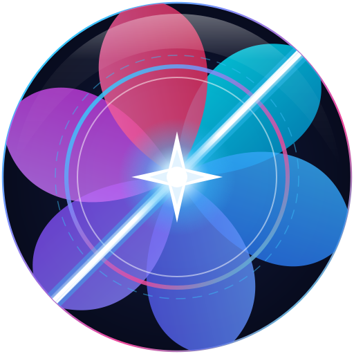
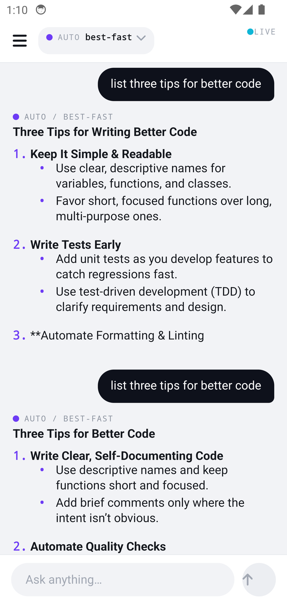
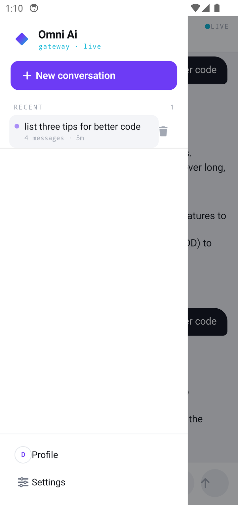
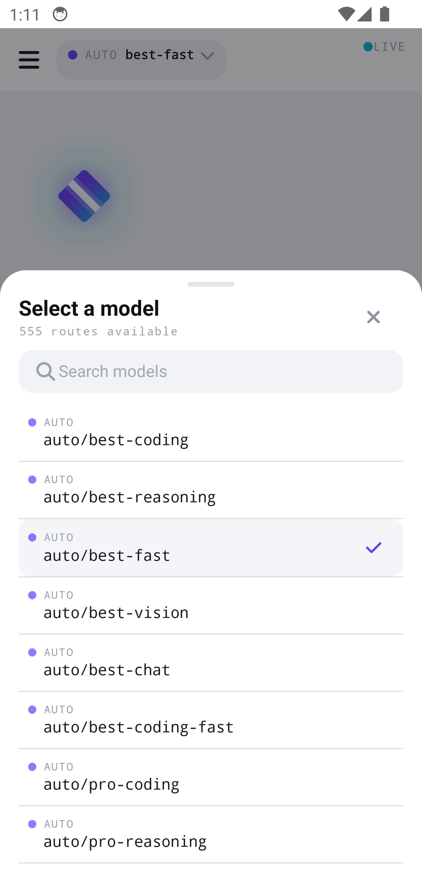
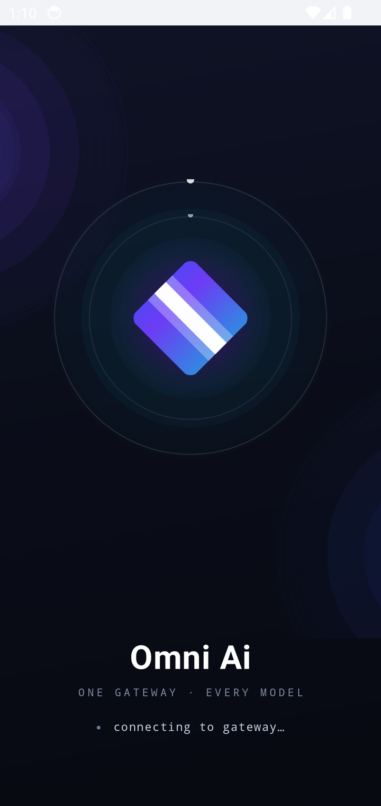
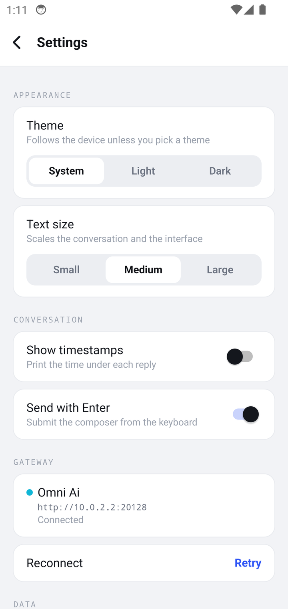
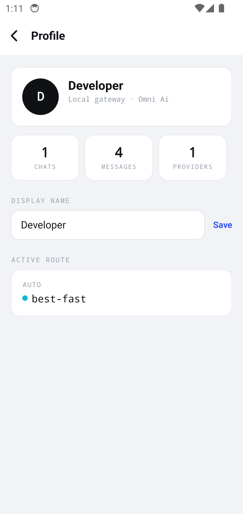

<div align="center">



# Omni Ai

### One gateway. Every model. An app that always knows **which one** it is talking to.

<sub>A NativeScript-Vue 3 client for an OpenAI compatible model gateway —<br>built around the idea that a route is a colour.</sub>

<br>


&nbsp;&nbsp;

&nbsp;&nbsp;


<br>

[](https://nativescript.org)
[](https://vuejs.org)
[](https://www.typescriptlang.org)
[](https://pinia.vuejs.org)
[](#credits)

</div>

---

## The idea

A gateway that publishes **several hundred routes** is not a menu, it is a maze. Most clients hide that: a grey dropdown, a model name, no sense of where the answer is coming from.

Omni Ai takes the opposite position. **The provider of the selected model is the accent colour of the entire interface.** Pick a route from `auto/` and the app is violet. Pick one from `aihorde/` and it turns green. The colour is not decoration - it is a label, it is a state, and it is the same colour on the send button, on the bullets of a reply, on the check next to the active model, and on the dot that says the gateway is live.

<div align="center">

&nbsp;&nbsp;&nbsp;

&nbsp;&nbsp;&nbsp;

</div>

---

## What it does

| | |
| :--- | :--- |
| **Every route** | The whole catalogue of the gateway, searchable, each with the colour of its provider. The route is in the app bar, and it is the accent of the app. |
| **Real Markdown** | A hand written parser and renderer: headings, bold, italic, strike, inline code, fenced code blocks, quotes, rules, and lists that nest under their item - the way they were written. |
| **A history that is a history** | Conversations are stored on the device, titled after what you asked, ordered by when you last used them. |
| **A drawer that goes somewhere** | New conversation, the history, and - at the very end - profile and settings. |
| **A theme that follows the device** | Light, dark, or follow the system, with one palette of tokens behind both. The switch is instant. |
| **Attachments and search** | Attach gallery images, camera photos, PDFs, and supported Office documents. Images are sent through the gateway's vision bridge; PDFs are rasterised on-device and Office files are converted to text. Search uses the same OpenAI-compatible gateway. |
| **A stop button** | The send button turns into a stop square while the answer is on its way, and it really cancels the request. |
| **Failures that are not part of the conversation** | A failed request is a banner above the composer with a retry - not a paragraph of stack trace in the middle of your chat. |
| **Motion with a purpose** | Every surface answers the finger, messages rise into place, the mark breathes, the launch sequence is built out of planes that move at their own rate. |

---

## The launch sequence

The app opens on ink. Behind the mark two aurora blobs drift at ninety-six and a hundred and eighteen seconds per cycle; around it two orbit rings turn at forty-four and thirty; the mark floats closest to the eye at thirteen, its glow breathing at nine, its beam pulsing at six.

Nothing moves in lockstep, so the composition reads as **depth** rather than as a set of decorations. Then the exit is a two stage crossfade: the ink dissolves into the colour the app uses, and only then does that dissolve into the chat - so there is never a moment where text sits on top of text.

---

## Under the hood

```
src/
├── app.ts                  the entry: Pinia + the v-press directive
├── App.vue                 the root <Frame> - it carries the theme
├── app.css                 the palette: light and dark, as CSS custom properties
├── components/
│   ├── Home.vue            the chat screen
│   ├── ChatMessage.vue     one message
│   ├── MarkdownView.vue    the blocks of a reply
│   ├── MdList.vue          a list of a reply (recursive)
│   ├── Icon.vue            the icon set
│   ├── Sidebar.vue         the drawer
│   ├── ModelSheet.vue      the routes
│   ├── Profile.vue         the operator
│   ├── Settings.vue        theme, text size, gateway, history
│   └── SplashScreen.vue    the launch sequence
├── stores/                 chat, settings, theme   (Pinia, persisted)
├── services/omni-ai.ts     the client of the gateway
├── utils/                  accent, theme, motion, markdown, parallax, tilt
├── directives/press.ts     the tactile feedback
└── assets/img/             the mark and the launch assets

App_Resources/Android/src/main/res/drawable/   the icon set (vector drawables)
```

Three decisions shape the code:

**A palette of tokens, not two sets of rules.** `app.css` declares the light and
the dark values once, and every component reads `var(--app-*)`. A hard coded
hex in a component is a bug - it cannot follow the theme.

**Motion lives in one place.** NativeScript's CSS keyframes do not run inside a
scoped style block, so `utils/motion.ts` owns the timing of everything: the
entrances, the press feedback, the loops. A loop always has a stop function,
because a chain that never ends will fill the heap and freeze the app.

**The icon set is native.** Every icon is an Android vector drawable, cut down
to the twenty-five shapes the interface uses and drawn by the platform itself.
A glyph is tinted with the colour of its role, so it follows the accent, and it
stays crisp at every density of the screen.

---

## Run it

The whole environment - the Android emulator, the noVNC view of it and the
development server - is one container.

```bash
git clone <this repository> omni-ai
cd omni-ai
docker compose up --build
```

Then open **[http://localhost:6080/vnc.html](http://localhost:6080/vnc.html)**
in a private window and the app boots into the launch sequence.

> Use a **private / incognito window**. A VPN or proxy extension that touches
> `localhost` crashes noVNC with `Cannot read properties of undefined (reading 'M_ID')`.

The app talks to a gateway on the host. From inside the emulator that is
`10.0.2.2` - the alias of the host machine. On a physical phone, forward the
port over wireless ADB and leave the app's gateway address unset:

```bash
adb connect <phone-ip>:<debug-port>
adb -s <phone-ip>:<debug-port> reverse tcp:20128 tcp:20128
adb -s <phone-ip>:<debug-port> shell \
  'curl -H "Authorization: Bearer $OMNIROUTE_API_KEY" http://127.0.0.1:20128/v1/models'
```

The app then uses `http://127.0.0.1:20128` on the phone. The emulator uses
`http://10.0.2.2:20128`; a manually configured gateway address overrides both.

For a quick phone validation, check the route list, attach a gallery image and
send a visual question, take a camera photo and send it, attach a PDF or
supported Office document, and run a search request. Capture both light and
dark
states after the requests complete; the route accent and gateway-live status
should remain visible in each theme.

---

## The design assets

Everything visual is generated, so the sources and the runtime files can never
drift apart.

```bash
python3 design/logo/build-assets.py   # the mark, the launcher icons, the splash
python3 design/icons/build_font.py    # the icon font
```

The mark is a square rotated 45 degrees, filled with the brand spectrum and
crossed by a single white beam: **one request in, one answer out**. It is the
same diamond the interface used as a glyph before it had a name.

| | |
| :--- | :--- |
| `cobalt` `#2F55F5` | The primary. The default accent of the app. |
| `iris` `#6D3BF5` | The mid stop of the spectrum. |
| `cyan` `#0FB6D6` | The live route. |
| `ink` `#0E111B` | The deep ground. |
| `paper` `#F2F3F6` | The canvas. |

---

## Before you change something

The NativeScript runtime is not a browser. A handful of rules in this codebase
were learned the hard way, and they are written down:

- **[`AGENTS.md`](AGENTS.md)** - the architecture, the rules, and a table of the
  NativeScript pitfalls (the CSS engine, the grid, the animation API, the
  theme tokens).
- **[`skills.md`](skills.md)** - the runbooks: how to run the container, how to
  get a change onto the device, and a diagnostic matrix for the failures that
  cost an afternoon.

Two of them are worth repeating here, because they are the ones that bite
first:

> **A `v-for` on a `<template>` inside a native view puts the element of the
> second round inside the element of the first one.** The blocks of a reply are
> rendered through a real element for that reason - otherwise a nested list was
> drawn in the row of the item above it.

> **An animation of a view that is not on screen is resolved at once.** A chain
> that starts the next frame from that callback spins the thread at full speed:
> the app stops answering and it runs out of memory. Every endless animation
> has a stop function.

---

## Credits

- The icons are the **[Material Icons](https://fonts.google.com/icons)** (Round),
  by Google, cut down to the shapes the app uses
  ([Apache 2.0](design/icons/MaterialIcons-LICENSE.txt)).
- The mark, the launcher icons and the launch assets are generated by
  `design/logo/build-assets.py`.
- Built with [NativeScript](https://nativescript.org),
  [NativeScript-Vue](https://github.com/nativescript-vue/nativescript-vue) and
  [Pinia](https://pinia.vuejs.org).
